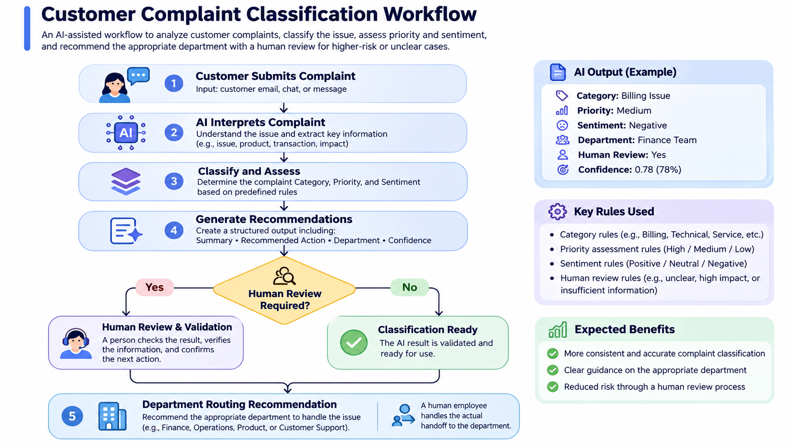

Customer Complaint Classification Workflow

An AI-assisted workflow prototype designed to classify customer complaints, assess priority, recommend the responsible department, and identify cases requiring human review.

## 1. Project Overview

Customer complaints often require manual review before they can be assigned to the appropriate department. Incorrect classification or priority assessment may cause delays and additional work.

This project explores how an AI-assisted workflow can support the initial complaint-handling process by producing structured and consistent recommendations.

## 2. Project Objectives

* Classify complaints into appropriate categories.
* Assess complaint priority based on business impact and urgency.
* Recommend the responsible department.
* Identify sentiment and summarize the complaint.
* Flag cases that require human review.
* Reduce repetitive manual classification work.
## Workflow Diagram

## 3. Workflow Process

1. Receive a customer complaint.
2. Interpret the complaint and identify relevant information.
3. Classify the complaint category and sentiment.
4. Assess priority using defined business rules.
5. Recommend the responsible department and next actions.
6. Flag uncertain or high-impact cases for human review.
7. A human reviews the result before further action.

## 4. Classification Categories

* Payroll Issue
* Billing Issue
* Technical Issue
* Service Quality
* General Inquiry

## 5. Priority Assessment

* High: Clear evidence of critical disruption, significant financial impact, or an urgent deadline.
* Medium: Investigation is required, but critical impact or urgency has not been established.
* Low: General inquiries or minor non-urgent requests.

## 6. Testing and Improvement

The workflow was evaluated using 20 scenario-based test cases covering different complaint types, priority levels, and situations requiring human review.

Testing helped identify areas where the classification rules needed improvement. For example, priority assessment was refined to avoid automatically assigning High priority simply because multiple departments were affected.

Sentiment classification rules were also clarified to distinguish between neutral descriptions of problems and complaints that express dissatisfaction.

## 7. Human Review and Safeguards

The workflow includes a human review step to help manage uncertainty and reduce the risk of incorrect decisions.

It is designed to:

* Avoid inventing missing information.
* Avoid assuming urgency without supporting evidence.
* Flag ambiguous cases for human review.
* Provide recommendations rather than claim that an issue has been resolved.
* Require human approval before any external action.

## 8. Tools and Approach

* ChatGPT Project Instructions
* Structured prompt design
* Scenario-based testing
* Rule refinement based on test results
* GitHub for project documentation

## 9. Limitations

This project is a prototype. Complaints are entered manually, and the workflow generates classification and routing recommendations.

It is not connected to a live email system, database, or external business application. Department routing and complaint resolution are not automated.

## 10. Project Outcome

This prototype demonstrates how structured AI instructions, business rules, testing, and human review can support a more consistent complaint classification process.

The intended benefits are to reduce repetitive manual work, support more accurate department recommendations, and help employees focus on investigating and resolving customer issues.

⸻

Project Type: AI-assisted Business Process Workflow Prototype
Focus: Business Process Analysis, AI Workflow Design, Process Improvement, Testing and Evaluation
